# Smart Mars Colony — Εργασία 1

**Μάθημα:** Αλληλεπίδραση Ανθρώπου–Υπολογιστή (Ακαδημαϊκό Έτος 2026–2027)  
**Διδάσκοντες:** Καθηγήτρια Μαρία Βίρβου – Δρ. Δημήτρης Παναγούλιας  
**Ομάδα:** Λεωνίδας Γλυνός (Π23028)  
**Παραδοτέο:** Ιεραρχική Ανάλυση Εργασιών (HTA), Αρχικά Διαδραστικά Πρωτότυπα Οθονών & Εγχειρίδια Χρήσης

---

## 1. Εισαγωγή & Πλαίσιο Συστήματος

Το **Smart Mars Colony** αποτελεί ένα διαδραστικό σύστημα παρακολούθησης και διαχείρισης μιας έξυπνης αποικίας στον Άρη, το οποίο συνδέει μετρήσεις εσωτερικών και εξωτερικών αισθητήρων με φυσικά μοντέλα υποστήριξης αποφάσεων. Η Εργασία 1 εστιάζει στην ανάλυση απαιτήσεων, στην Ιεραρχική Ανάλυση Εργασιών (Hierarchical Task Analysis — HTA), στον σχεδιασμό αρχικών διαδραστικών πρωτοτύπων οθονών και στα συνοδευτικά εγχειρίδια χρήσης για δύο αντιπροσωπευτικές λειτουργίες:

1. **Λειτουργία Α:** Ρύθμιση θερμοκρασίας χώρου κατοίκησης (Υποσύστημα Α — Υποστήριξη Ζωής).
2. **Λειτουργία Β:** Προγραμματισμός άρδευσης θερμοκηπίου (Υποσύστημα Β — Θερμοκήπια, Νερό & Ενέργεια).

---

## 2. Λειτουργία Α — Ρύθμιση Θερμοκρασίας Χώρου Κατοίκησης

### 2.1 Προδιαγραφή Σεναρίου, Ρόλου & Φυσικού Μοντέλου

- **Ρόλος Χρήστη:** Υπεύθυνος Υποστήριξης Ζωής (*Life Support Officer*).
- **Στόχος:** Παρακολούθηση των εσωτερικών και εξωτερικών θερμικών συνθηκών ενός επιλεγμένου χώρου της αποικίας και ασφαλής μεταβολή της επιθυμητής θερμοκρασίας με προηγούμενη εκτίμηση της ενεργειακής επίπτωσης.
- **Προϋποθέσεις:**
  - Ο χρήστης διαθέτει ενεργά δικαιώματα του ρόλου *Υπεύθυνος Υποστήριξης Ζωής*.
  - Οι εσωτερικοί αισθητήρες θερμοκρασίας των χώρων και ο εξωτερικός μετεωρολογικός αισθητήρας (`EXT-MET-A1`) παρέχουν πρόσφατες, αξιόπιστες μετρήσεις.
  - Το σύστημα θέρμανσης/κλιματισμού είναι συνδεδεμένο και διαθέσιμο για αποδοχή εντολών.

#### Φυσικό Μοντέλο Θερμικών Απωλειών
Η απαιτούμενη θερμική ισχύς διατήρησης θερμοκρασίας μοντελοποιείται βάσει του νόμου μεταφοράς θερμότητας σε μόνιμη κατάσταση:

$$\dot{Q} = U \cdot A \cdot (T_{\text{εντ}} - T_{\text{εκτ}})$$

όπου:
- $\dot{Q}$: Ρυθμός μετάδοσης θερμότητας / απαιτούμενη θερμική ισχύς ($\text{W}$ ή $\text{J/s}$).
- $U$: Συνολικός συντελεστής θερμοπερατότητας του περιβλήματος ($\text{W/(m}^2\cdot\text{K)}$).
- $A$: Συνολική επιφάνεια θερμικής ανταλλαγής του χώρου ($\text{m}^2$).
- $T_{\text{εντ}}$: Εσωτερική θερμοκρασία του χώρου ($\text{K}$, προβάλλεται παράλληλα σε $^{\circ}\text{C}$).
- $T_{\text{εκτ}}$: Εξωτερική θερμοκρασία περιβάλλοντος Άρη ($\text{K}$, προβάλλεται παράλληλα σε $^{\circ}\text{C}$).

**Παραδοχές & Πεδίο Εγκυρότητας:** Υποτίθεται σταθερός συντελεστής $U$, αγνοούνται ηλιακά και εσωτερικά θερμικά κέρδη (μεταβολικά/εξοπλισμού) και ισχύει για $T_{\text{εντ}} \ge T_{\text{εκτ}}$ (αποτροπή αρνητικών απωλειών: $\dot{Q} \ge 0$). Οι τιμές ασφαλών ορίων αποτελούν εκπαιδευτικές παραδοχές του σεναρίου.

#### Παράμετροι Χώρων Αποικίας

| Κωδικός | Χώρος | Επιφάνεια $A$ ($\text{m}^2$) | Συντελεστής $U$ ($\text{W/(m}^2\cdot\text{K)}$) | Αρχική $T_{\text{εντ}}$ | Ασφαλές Εύρος ($^{\circ}\text{C}$) |
| :--- | :--- | :---: | :---: | :---: | :---: |
| `HAB-01` | Κεντρικός Θόλος | 500 | 0.20 | 20.0 °C (293.15 K) | 16.0 – 26.0 °C |
| `HAB-02` | Κοιτώνες Πληρώματος | 320 | 0.18 | 19.5 °C (292.65 K) | 16.0 – 25.0 °C |
| `MED-03` | Ιατρείο | 180 | 0.16 | 22.0 °C (295.15 K) | 19.0 – 25.0 °C |
| `LAB-04` | Εργαστήριο Κατασκευών | 420 | 0.24 | 18.0 °C (291.15 K) | 14.0 – 24.0 °C |
| `BIO-05` | Θερμοκήπιο | 360 | 0.28 | 23.0 °C (296.15 K) | 18.0 – 28.0 °C |
| `SRV-06` | Server Room | 140 | 0.15 | 16.5 °C (289.65 K) | 12.0 – 22.0 °C |

**Αριθμητικό Παράδειγμα (Κεντρικός Θόλος `HAB-01`):**  
Με εξωτερική θερμοκρασία $T_{\text{εκτ}} = -60.0\,^{\circ}\text{C} = 213.15\text{ K}$, $U = 0.20\text{ W/(m}^2\cdot\text{K)}$ και $A = 500\text{ m}^2$:
- Στην αρχική κατάσταση ($T_{\text{εντ}} = 20.0\,^{\circ}\text{C} = 293.15\text{ K}$): $\dot{Q}_{\text{τρέχ}} = 0.20 \cdot 500 \cdot (293.15 - 213.15) = 8\,000\text{ W}$.
- Για αύξηση της επιθυμητής θερμοκρασίας στους $22.0\,^{\circ}\text{C}$ ($295.15\text{ K}$): $\dot{Q}_{\text{νέα}} = 0.20 \cdot 500 \cdot (295.15 - 213.15) = 8\,200\text{ W}$.
- Ενεργειακή επίπτωση: $\Delta\dot{Q} = +200\text{ W}$ ($+2.5\%$).

#### Βασικό Σενάριο (Happy Path)
1. Ο Υπεύθυνος Υποστήριξης Ζωής επιλέγει έναν χώρο (π.χ. *Κεντρικός Θόλος*) από τη λίστα χώρων.
2. Το σύστημα ανακτά και προβάλλει την εσωτερική και εξωτερική θερμοκρασία (σε $^{\circ}\text{C}$ και $\text{K}$), την ώρα μέτρησης, την πηγή, την ποιότητα δεδομένων, την τάση μεταβολής και το ασφαλές εύρος του χώρου.
3. Ο χρήστης περιστρέφει δεξιόστροφα (ή αριστερόστροφα) το κυκλικό χειριστήριο θερμοκρασίας (ή χρησιμοποιεί τα πλήκτρα `− / +`, βελάκια πληκτρολογίου ή το αριθμητικό πεδίο) για να ορίσει νέα επιθυμητή θερμοκρασία (π.χ. `22.0 °C` / `295.15 K`).
4. Το σύστημα ελέγχει άμεσα την εγκυρότητα της τιμής, υπολογίζει τη νέα απαίτηση θέρμανσης $\dot{Q}_{\text{νέα}}$, τη μεταβολή $\Delta\dot{Q}$ και την εκτίμηση επίπτωσης στην εφεδρική αυτονομία και τα προβάλλει στην κάρτα προεπισκόπησης.
5. Ο χρήστης εξετάζει την ενεργειακή επίπτωση (και προαιρετικά τις παραδοχές του μοντέλου) και επιλέγει «Επιβεβαίωση & Εφαρμογή».
6. Το σύστημα ανοίγει διάλογο επιβεβαίωσης κρίσιμης εντολής με σύνοψη στόχου και συνεπειών. Ο χρήστης πατά «Επιβεβαίωση Εντολής».
7. Το σύστημα προσομοιώνει την αποστολή εντολής και ενημερώνει σταδιακά τον χρήστη για τα 3 στάδια: **Αποδοχή → Πρόοδος προσαρμογής → Επιτυχής ολοκλήρωση**, παρέχοντας και δυνατότητα αναίρεσης.

#### Περιπτώσεις Σφάλματος & Ακύρωσης
- **Περίπτωση 1 — Τιμή εκτός ορίων ασφαλείας:** Αν ο χρήστης εισαγάγει τιμή εκτός του ασφαλούς εύρους του επιλεγμένου χώρου (π.χ. `32.0 °C` στον Κεντρικό Θόλο), το κυκλικό τόξο αλλάζει σε κόκκινη/πορτοκαλί ένδειξη με λεκτική ετικέτα «Εκτός ασφαλών ορίων», το κουμπί εφαρμογής απενεργοποιείται και εμφανίζεται ειδοποίηση με σοβαρότητα, αιτία, επίπτωση και κουμπί επαναφοράς.
- **Περίπτωση 2 — Απώλεια εσωτερικού αισθητήρα:** Αν χαθεί το σήμα του αισθητήρα, η ένδειξη ποιότητας αλλάζει σε «✕ Απώλεια σήματος», ο υπολογισμός $\dot{Q}$ και το χειριστήριο κλειδώνουν ώστε να αποτραπεί μη τεκμηριωμένη εντολή, και προβάλλεται κρίσιμη ειδοποίηση με ενέργεια ανάκαμψης (επανασύνδεση αισθητήρα).
- **Περίπτωση 3 — Ακύρωση μετά την προεπισκόπηση:** Αν ο χρήστης πατήσει «Ακύρωση» στον διάλογο επιβεβαίωσης, δεν εκτελείται καμία αλλαγή και εμφανίζεται σαφής επιβεβαίωση ακύρωσης.

---

### 2.2 Ιεραρχική Ανάλυση Εργασιών (HTA) — Λειτουργία Α

> **Σύμβαση διαχωρισμού ρόλων στο διάγραμμα:**
> - **Ενέργειες Χρήστη** (μοβ περίγραμμα / ετικέτα `[Χρήστης]`)
> - **Έλεγχοι & Αποκρίσεις Συστήματος** (διακεκομμένο γαλάζιο/γκρι πλαίσιο / ετικέτα `[Σύστημα]`)

```mermaid
flowchart TD
    G0["0. Ρύθμιση θερμοκρασίας χώρου κατοίκησης<br/>(Κεντρικός Στόχος)"]

    G1["1. Επιλογή χώρου & έλεγχος συνθηκών"]
    G1_1["1.1 [Χρήστης] Επιλογή χώρου από τη λίστα<br/>(6 χώροι αποικίας)"]
    G1_2["1.2 [Σύστημα] Ανάκτηση & έλεγχος διαθεσιμότητας<br/>εσωτερικού/εξωτερικού αισθητήρα"]
    G1_3["1.3 [Σύστημα] Προβολή Tεντ, Tεκτ (°C & K),<br/>ώρας μέτρησης, ποιότητας & τάσης"]
    G1_4["1.4 [Χρήστης] Αξιολόγηση τρεχουσών συνθηκών<br/>και αξιοπιστίας μετρήσεων"]

    G2["2. Ορισμός νέας επιθυμητής θερμοκρασίας"]
    G2_1["2.1 [Χρήστης] Μεταβολή τιμής μέσω κυκλικού slider,<br/>πλήκτρων −/+ ή αριθμητικού πεδίου"]
    G2_2["2.2 [Σύστημα] Έλεγχος εγκυρότητας τιμής<br/>ως προς το ασφαλές εύρος του χώρου"]
    G2_3["2.3 [Σύστημα] Προειδοποίηση σφάλματος & κλείδωμα<br/>εφαρμογής αν η τιμή είναι εκτός ορίων"]

    G3["3. Αξιολόγηση ενεργειακής επίπτωσης"]
    G3_1["3.1 [Σύστημα] Υπολογισμός Q̇ = U·A·(Tεντ − Tεκτ),<br/>μεταβολής ΔQ̇ & επίπτωσης αυτονομίας"]
    G3_2["3.2 [Σύστημα] Προβολή προεπισκόπησης & παραδοχών"]
    G3_3["3.3 [Χρήστης] Εξέταση κόστους ισχύος & απόφαση<br/>(Συνέχεια / Τροποποίηση / Επαναφορά)"]

    G4["4. Επιβεβαίωση ή ακύρωση εντολής"]
    G4_1["4.1 [Χρήστης] Επιλογή «Επιβεβαίωση & Εφαρμογή»"]
    G4_2["4.2 [Σύστημα] Εμφάνιση διαλόγου επιβεβαίωσης<br/>με σύνοψη στόχου & συνεπειών"]
    G4_3["4.3 [Χρήστης] Επιβεβαίωση Εντολής ή Ακύρωση"]

    G5["5. Εκτέλεση εντολής & ανατροφοδότηση"]
    G5_1["5.1 [Σύστημα] Αποστολή εντολής & σήμανση «Αποδοχή»"]
    G5_2["5.2 [Σύστημα] Προσομοίωση προόδου & live ενημέρωση Tεντ"]
    G5_3["5.3 [Σύστημα] Επιβεβαίωση ολοκλήρωσης & επιλογή αναίρεσης"]
    G5_4["5.4 [Χρήστης] Επαλήθευση νέας θερμοκρασίας<br/>(ή εκτέλεση αναίρεσης)"]

    G0 --> G1
    G0 --> G2
    G0 --> G3
    G0 --> G4
    G0 --> G5

    G1 --> G1_1 & G1_2 & G1_3 & G1_4
    G2 --> G2_1 & G2_2 & G2_3
    G3 --> G3_1 & G3_2 & G3_3
    G4 --> G4_1 & G4_2 & G4_3
    G5 --> G5_1 & G5_2 & G5_3 & G5_4

    classDef userNode fill:#261b47,stroke:#c084fc,stroke-width:2px,color:#f3f0ff;
    classDef sysNode fill:#151d33,stroke:#60a5fa,stroke-width:1.5px,stroke-dasharray: 5 3,color:#e2e8f0;
    classDef goalNode fill:#3b1f6e,stroke:#a855f7,stroke-width:2px,color:#ffffff;

    class G0,G1,G2,G3,G4,G5 goalNode;
    class G1_1,G1_4,G2_1,G3_3,G4_1,G4_3,G5_4 userNode;
    class G1_2,G1_3,G2_2,G2_3,G3_1,G3_2,G4_2,G5_1,G5_2,G5_3 sysNode;
```

#### Σχέδια Εκτέλεσης (Plans) — Λειτουργία Α
- **Σχέδιο 0 (Κύρια Ροή):** Εκτέλεση `1 → 2 → 3 → 4 → 5` σειριακά. Εάν στο βήμα `1.2` ανιχνευθεί απώλεια εσωτερικού αισθητήρα, διακοπή της ροής, κλείδωμα των βημάτων `2–5` και εμφάνιση διαδικασίας ανάκαμψης.
- **Σχέδιο 1 (Έλεγχος Συνθηκών):** Εκτέλεση `1.1 → 1.2 → 1.3 → 1.4`. Εάν η εξωτερική μέτρηση επισημανθεί ως παρωχημένη, ο χρήστης προτρέπεται σε επαλήθευση της πηγής πριν προχωρήσει στο `4`.
- **Σχέδιο 2 (Ορισμός Τιμής):** Εκτέλεση `2.1 → 2.2`. Εάν η τιμή είναι εκτός ασφαλούς εύρους, εκτέλεση `2.3` και επανάληψη του `2.1` (βρόχος διόρθωσης) έως ότου εισαχθεί έγκυρη τιμή.
- **Σχέδιο 3 (Προεπισκόπηση Επίπτωσης):** Εκτέλεση `3.1 → 3.2 → 3.3` σε πραγματικό χρόνο με κάθε έγκυρη μεταβολή του `2.1`. Αν το ενεργειακό κόστος κριθεί υψηλό, ο χρήστης επιστρέφει στο `2.1` ή επιλέγει «Επαναφορά».
- **Σχέδιο 4 (Επιβεβαίωση):** Εκτέλεση `4.1 → 4.2 → 4.3`. Σε επιλογή «Επιβεβαίωση Εντολής», μετάβαση στο `5`. Σε επιλογή «Ακύρωση», επιστροφή στην κατάσταση προεπισκόπησης με ενημερωτικό μήνυμα ακύρωσης και χωρίς αλλαγή στον ελεγκτή.
- **Σχέδιο 5 (Εκτέλεση & Επαλήθευση):** Εκτέλεση `5.1 → 5.2 → 5.3 → 5.4`. Προαιρετικά στο `5.4`, αν ο χρήστης επιλέξει «Αναίρεση αλλαγής», εκτελείται εκ νέου το `5` με στόχο την προηγούμενη θερμοκρασία.

---

### 2.3 Πρωτότυπο Οθονών & Αντιστοίχιση HTA (Λειτουργία Α)

Το διαδραστικό πρωτότυπο υλοποιήθηκε στον φάκελο `prototypes/` (`index.html`, `styles.css`, `app.js`) με minimal, σκούρα μωβ αισθητική και διάταξη δύο στηλών, περιλαμβάνοντας κυκλικό χειριστήριο θερμοκρασίας με ταυτόχρονη προβολή $^{\circ}\text{C}$ και $\text{K}$.

| Βήμα HTA | Ρόλος | Στοιχείο Διεπαφής (UI) | Σχετική Ενότητα Εγχειριδίου |
| :--- | :---: | :--- | :--- |
| `1.1` Επιλογή χώρου | Χρήστης | Πλέγμα επιλογής 6 χώρων (`#room-list`: Κεντρικός Θόλος, Κοιτώνες, Ιατρείο, Εργαστήριο Κατασκευών, Θερμοκήπιο, Server Room) | Σημειώσεις Εκκίνησης §2.1 |
| `1.2 – 1.3` Ανάκτηση & προβολή συνθηκών | Σύστημα | Κάρτες Εσωτερικού & Εξωτερικού Αισθητήρα (τιμή σε °C/K, πηγή, ώρα μέτρησης, σήμα ποιότητας, τάση, ΔT, ασφαλές εύρος) | Σύντομη Αναφορά §1–2 |
| `2.1` Ορισμός επιθυμητής τιμής | Χρήστης | Κυκλικό slider (`#dial-control`, δεξιόστροφη αύξηση / αριστερόστροφη μείωση, κεντρική ένδειξη °C & K), πλήκτρα `−/+`, αριθμητικό πεδίο & βελάκια πληκτρολογίου | Σημειώσεις Εκκίνησης §2.1 & Σύντομη Αναφορά §4 |
| `2.2 – 2.3` Έλεγχος ορίων & σφάλματα | Σύστημα | Χρωματισμός τόξου (μωβ/κόκκινο), ετικέτα κατάστασης (`#target-status-tag`), μπάρα ειδοποιήσεων (`#alert-banner`) με αιτία/επίπτωση/ανάκαμψη & κλείδωμα κουμπιού | Σύντομη Αναφορά §3 |
| `3.1 – 3.3` Προεπισκόπηση επίπτωσης | Σύστημα / Χρήστης | Κάρτα «Απαίτηση Θερμικής Ισχύος» ($\dot{Q}_{\text{τρέχ}} \rightarrow \dot{Q}_{\text{νέα}}$, $\Delta\dot{Q}$, επίπτωση αυτονομίας) & αναδιπλούμενο πλαίσιο παραδοχών μοντέλου | Σημειώσεις Εκκίνησης §2.1 & Σύντομη Αναφορά §2 |
| `4.1 – 4.3` Επιβεβαίωση / Ακύρωση | Χρήστης / Σύστημα | Κουμπί «Επιβεβαίωση & Εφαρμογή» → Modal επιβεβαίωσης κρίσιμης εντολής (`#confirm-modal`) με σύνοψη και κουμπιά «Επιβεβαίωση Εντολής» / «Ακύρωση» | Σημειώσεις Εκκίνησης §2.1 |
| `5.1 – 5.4` Εκτέλεση, πρόοδος & αναίρεση | Σύστημα / Χρήστης | Κάρτα προόδου (`#execution-panel`) με μπάρα %, 3 δείκτες σταδίων (Αποδοχή → Πρόοδος → Ολοκλήρωση), live ενημέρωση $T_{\text{εντ}}$ και κουμπί «Αναίρεση αλλαγής» | Σημειώσεις Εκκίνησης §2.1 & Σύντομη Αναφορά §3 |

---

---

## 3. Λειτουργία Β — Προγραμματισμός Άρδευσης Θερμοκηπίου

### 3.1 Προδιαγραφή Σεναρίου, Ρόλου & Μοντέλου Υδατικού Ισοζυγίου

- **Ρόλος Χρήστη:** Υπεύθυνος Πόρων (*Resources Officer*).
- **Στόχος:** Προγραμματισμός άρδευσης επιλεγμένης ζώνης καλλιέργειας στο θερμοκήπιο με διασφάλιση της επάρκειας αποθεμάτων νερού, τήρηση της ελάχιστης συντηρητικής εφεδρείας και παρακολούθηση της προσομοιωμένης εκτέλεσης.
- **Προϋποθέσεις:**
  - Ο χρήστης διαθέτει δικαιώματα του ρόλου *Υπεύθυνος Πόρων*.
  - Υπάρχουν διαθέσιμες και αξιόπιστες μετρήσεις υγρασίας υποστρώματος ανά ζώνη (`SOIL-Z1` έως `SOIL-Z4`) και στάθμης της κεντρικής δεξαμενής άρδευσης (`TANK-W1`).
  - Έχει οριστεί το όριο ελάχιστης συντηρητικής εφεδρείας ασφαλείας ($V_{\min} = 200\text{ L}$).

#### Μοντέλο Υδατικού Ισοζυγίου & Κανόνας Μη Διπλομέτρησης
Η δεξαμενή άρδευσης `TANK-W1` έχει μέγιστη χωρητικότητα $V_{\max} = 1\,000\text{ L}$ ($1.00\text{ m}^3$) και ελάχιστη υποχρεωτική εφεδρεία $V_{\min} = 200\text{ L}$ ($20\%$). Το πραγματικά αξιοποιήσιμο νερό για άρδευση ορίζεται ως:

$$V_{\text{διαθ}} = \max(0,\; V_{\text{τρέχ}} - V_{\min})$$

Κατά τον έλεγχο επάρκειας μιας προγραμματιζόμενης άρδευσης όγκου $V_{\text{άρδ}}$, η προβλεπόμενη στιγμιαία στάθμη μετά την παροχή είναι:

$$V_{\text{νέο}} = V_{\text{τρέχ}} - V_{\text{άρδ}}, \quad \text{με συνθήκη εγκυρότητας } V_{\text{νέο}} \ge V_{\min}$$

**Κανόνας μη διπλομέτρησης ανακυκλωμένου νερού:** Παρότι το σύστημα ανακύκλωσης έχει συντελεστή ανάκτησης $r = 0.70$ (με καθαρή απώλεια κύκλου $V_{\text{απώλ}} = (1 - r)\cdot V_{\text{άρδ}}$ και μελλοντική επιστροφή $V_{\text{ανακ}} = r\cdot V_{\text{άρδ}}$), το ανακυκλωμένο νερό επιστρέφει με χρονική υστέρηση και **δεν** προσμετράται εκ των προτέρων στο τρέχον διαθέσιμο απόθεμα $V_{\text{διαθ}}$. Έτσι αποτρέπονται τόσο η διπλομέτρηση όσο και η δημιουργία αρνητικών αποθεμάτων.

#### Παράμετροι Ζωνών Θερμοκηπίου

| Κωδικός | Ζώνη Καλλιέργειας | Ενδεικτικές Καλλιέργειες | Αρχική Υγρασία | Ιδανικό Εύρος | Συνιστώμενη Δόση | Αισθητήρας |
| :--- | :--- | :--- | :---: | :---: | :---: | :---: |
| `GH-Z1` | Ζώνη Α — Δέντρα | Πορτοκάλια, μήλα & εσπεριδοειδή | 42.0% | 45% – 65% | 60 – 120 L | `SOIL-Z1` |
| `GH-Z2` | Ζώνη Β — Καλλιέργειες Εδάφους | Καρότα, πατάτες & βολβοί | 38.0% | 50% – 70% | 40 – 100 L | `SOIL-Z2` |
| `GH-Z3` | Ζώνη Γ — Βότανα | Τσάι, δυόσμος & αρωματικά | 51.0% | 45% – 60% | 15 – 45 L | `SOIL-Z3` |
| `GH-Z4` | Ζώνη Δ — Θάμνοι | Φράουλες, μούρα & μικροί θάμνοι | 44.0% | 55% – 75% | 30 – 75 L | `SOIL-Z4` |

**Αριθμητικό Παράδειγμα (Ζώνη Α — Δέντρα `GH-Z1`):**  
Με τρέχουσα στάθμη $V_{\text{τρέχ}} = 620\text{ L}$ ($0.62\text{ m}^3$, $62.0\%$) και ελάχιστη εφεδρεία $V_{\min} = 200\text{ L}$:
- Αξιοποιήσιμο απόθεμα: $V_{\text{διαθ}} = 620 - 200 = 420\text{ L}$.
- Επιλογή άρδευσης $V_{\text{άρδ}} = 80\text{ L}$ στις `Sol 14:35`:
  - Στιγμιαία νέα στάθμη: $V_{\text{νέο}} = 620 - 80 = 540\text{ L} \ge 200\text{ L}$ (έγκυρο, περιθώριο ασφαλείας $+340\text{ L}$).
  - Εκτιμώμενη υγρασία υποστρώματος: $42.0\% + 80 \times 0.18\% = 56.4\%$ (εντός ιδανικού εύρους $45\text{–}65\%$).
  - Μελλοντική ανάκτηση μέσω ανακύκλωσης: $\approx 56\text{ L}$, καθαρή απώλεια κύκλου: $\approx 24\text{ L}$.

#### Βασικό Σενάριο (Happy Path)
1. Ο Υπεύθυνος Πόρων επιλέγει μια ζώνη θερμοκηπίου (π.χ. *Ζώνη Α — Δέντρα*).
2. Το σύστημα προβάλλει την υγρασία υποστρώματος της ζώνης (με ιδανικό εύρος, αισθητήρα, ώρα μέτρησης και τάση) και την οπτική δεξαμενή νερού `TANK-W1` (τρέχουσα στάθμη σε `L`, `m³` και `%`, αξιοποιήσιμο απόθεμα και γραμμή ελάχιστης εφεδρείας `200 L`).
3. Ο χρήστης ορίζει ώρα έναρξης (π.χ. `Sol 14:35`) και ποσότητα άρδευσης (π.χ. `80 L`) μέσω slider, γρήγορων επιλογών ή αριθμητικού πεδίου.
4. Το σύστημα ελέγχει τη διαθεσιμότητα νερού, απεικονίζει πάνω στη δεξαμενή τη ζώνη εκτιμώμενης κατανάλωσης, υπολογίζει τη νέα στάθμη (`540 L`) και την εκτιμώμενη υγρασία (`56.4%`) και προβάλλει το περιθώριο πάνω από την εφεδρεία.
5. Ο χρήστης επιλέγει «Επιβεβαίωση & Αποθήκευση» και επιβεβαιώνει στον διάλογο επιβεβαίωσης.
6. Το σύστημα αποθηκεύει το πρόγραμμα στη λίστα ενεργών προγραμμάτων. Κατά την προσομοιωμένη εκτέλεση («▶ Προσομοίωση Εκτέλεσης»), το σύστημα επαληθεύει ξανά το απόθεμα και ενημερώνει live τη στάθμη της δεξαμενής (με κινούμενη ροή), την υγρασία του υποστρώματος και την κατάσταση ολοκλήρωσης.

#### Περιπτώσεις Σφάλματος & Ακύρωσης
- **Περίπτωση 1 — Ανεπαρκές απόθεμα / Παραβίαση ελάχιστης εφεδρείας:** Εάν το ζητούμενο $V_{\text{άρδ}}$ ρίχνει τη στάθμη κάτω από τα `200 L` (π.χ. στάθμη `230 L` και αίτημα `80 L`), η δεξαμενή και η ένδειξη κατάστασης επισημαίνονται ως «Ανεπαρκές απόθεμα», το κουμπί αποθήκευσης κλειδώνει και εμφανίζεται ειδοποίηση σφάλματος με αιτία, επίπτωση και κουμπί αυτόματης προσαρμογής στη μέγιστη ασφαλή δόση.
- **Περίπτωση 2 — Αποτυχία βαλβίδας κατά την εκτέλεση:** Κατά τη διάρκεια της προσομοιωμένης άρδευσης, αν ανιχνευθεί εμπλοκή/απώλεια πίεσης βαλβίδας, το σύστημα διακόπτει αυτόματα την παροχή, ενημερώνει τη στάθμη με την πραγματικά καταναλωθείσα ποσότητα, επισημαίνει το πρόγραμμα ως «Απέτυχε» και προβάλλει κατανοητό μήνυμα ανάκαμψης με επιλογή επανάληψης.
- **Περίπτωση 3 — Ακύρωση:** Ο χρήστης μπορεί να ακυρώσει τόσο στον διάλογο επιβεβαίωσης όσο και από τη λίστα αποθηκευμένων προγραμμάτων πριν από την εκτέλεση.

---

### 3.2 Ιεραρχική Ανάλυση Εργασιών (HTA) — Λειτουργία Β

```mermaid
flowchart TD
    B0["0. Προγραμματισμός άρδευσης θερμοκηπίου<br/>(Κεντρικός Στόχος)"]

    B1["1. Επιλογή ζώνης & έλεγχος αποθέματος"]
    B1_1["1.1 [Χρήστης] Επιλογή ζώνης θερμοκηπίου<br/>(Δέντρα / Έδαφος / Βότανα / Θάμνοι)"]
    B1_2["1.2 [Σύστημα] Ανάκτηση & προβολή υγρασίας υποστρώματος<br/>και στάθμης δεξαμενής TANK-W1 με όριο εφεδρείας"]
    B1_3["1.3 [Χρήστης] Αξιολόγηση ανάγκης άρδευσης<br/>και διαθέσιμου νερού"]

    B2["2. Ορισμός ώρας έναρξης & ποσότητας"]
    B2_1["2.1 [Χρήστης] Καθορισμός ώρας έναρξης (Sol)<br/>και ποσότητας άρδευσης σε L"]
    B2_2["2.2 [Σύστημα] Έλεγχος εγκυρότητας επιλογών<br/>και επάρκειας νερού (Vτρέχ − Vάρδ ≥ Vmin)"]
    B2_3["2.3 [Σύστημα] Ειδοποίηση ανεπάρκειας & αποκλεισμός<br/>αποθήκευσης αν παραβιάζεται η εφεδρεία"]

    B3["3. Προεπισκόπηση επίπτωσης στο απόθεμα"]
    B3_1["3.1 [Σύστημα] Υπολογισμός νέας στάθμης, περιθωρίου εφεδρείας<br/>και εκτιμώμενης υγρασίας (χωρίς διπλομέτρηση)"]
    B3_2["3.2 [Σύστημα] Οπτική απεικόνιση κατανάλωσης στη δεξαμενή"]
    B3_3["3.3 [Χρήστης] Εξέταση επίπτωσης & απόφαση<br/>(Συνέχεια / Τροποποίηση / Επαναφορά)"]

    B4["4. Επιβεβαίωση & αποθήκευση προγράμματος"]
    B4_1["4.1 [Χρήστης] Επιλογή «Επιβεβαίωση & Αποθήκευση»"]
    B4_2["4.2 [Σύστημα] Προβολή διαλόγου επιβεβαίωσης με σύνοψη"]
    B4_3["4.3 [Χρήστης] Επιβεβαίωση ή Ακύρωση"]
    B4_4["4.4 [Σύστημα] Αποθήκευση προγράμματος στη λίστα ενεργών"]

    B5["5. Προσομοιωμένη εκτέλεση & ενημέρωση κατάστασης"]
    B5_1["5.1 [Χρήστης] Εκκίνηση προσομοίωσης εκτέλεσης (ή ακύρωση)"]
    B5_2["5.2 [Σύστημα] Επανέλεγχος επάρκειας νερού & άνοιγμα βαλβίδας"]
    B5_3["5.3 [Σύστημα] Live ενημέρωση στάθμης δεξαμενής,<br/>υγρασίας υποστρώματος & προόδου (%)"]
    B5_4["5.4 [Σύστημα] Ολοκλήρωση ή ασφαλής διακοπή με μήνυμα αποτυχίας"]

    B0 --> B1 & B2 & B3 & B4 & B5
    B1 --> B1_1 & B1_2 & B1_3
    B2 --> B2_1 & B2_2 & B2_3
    B3 --> B3_1 & B3_2 & B3_3
    B4 --> B4_1 & B4_2 & B4_3 & B4_4
    B5 --> B5_1 & B5_2 & B5_3 & B5_4

    classDef userNode fill:#261b47,stroke:#c084fc,stroke-width:2px,color:#f3f0ff;
    classDef sysNode fill:#151d33,stroke:#60a5fa,stroke-width:1.5px,stroke-dasharray: 5 3,color:#e2e8f0;
    classDef goalNode fill:#3b1f6e,stroke:#a855f7,stroke-width:2px,color:#ffffff;

    class B0,B1,B2,B3,B4,B5 goalNode;
    class B1_1,B1_3,B2_1,B3_3,B4_1,B4_3,B5_1 userNode;
    class B1_2,B2_2,B2_3,B3_1,B3_2,B4_2,B4_4,B5_2,B5_3,B5_4 sysNode;
```

#### Σχέδια Εκτέλεσης (Plans) — Λειτουργία Β
- **Σχέδιο 0 (Κύρια Ροή):** Εκτέλεση `1 → 2 → 3 → 4 → 5` σειριακά.
- **Σχέδιο 1 (Έλεγχος Κατάστασης):** Εκτέλεση `1.1 → 1.2 → 1.3`. Αν το αξιοποιήσιμο νερό είναι μηδενικό, απαιτείται αναπλήρωση δεξαμενής πριν από το `2`.
- **Σχέδιο 2 (Παραμετροποίηση & Έλεγχος):** Εκτέλεση `2.1 → 2.2`. Αν η επιλεγμένη ποσότητα παραβιάζει την ελάχιστη εφεδρεία (`200 L`) ή είναι μη έγκυρη, εκτέλεση `2.3` και επανάληψη του `2.1` (βρόχος διόρθωσης ή χρήση της προτεινόμενης ασφαλούς προσαρμογής).
- **Σχέδιο 3 (Προεπισκόπηση):** Εκτέλεση `3.1 → 3.2 → 3.3` σε πραγματικό χρόνο με κάθε μεταβολή της ποσότητας. Αν η επίπτωση κριθεί υψηλή, επιστροφή στο `2.1` ή επαναφορά.
- **Σχέδιο 4 (Αποθήκευση):** Εκτέλεση `4.1 → 4.2 → 4.3`. Σε επιβεβαίωση, εκτέλεση `4.4`. Σε ακύρωση, επιστροφή χωρίς αποθήκευση και ενημέρωση χρήστη.
- **Σχέδιο 5 (Εκτέλεση):** Εκτέλεση `5.1 → 5.2`. Αν αποτύχει ο επανέλεγχος επάρκειας, άμεση μετάβαση στο `5.4` (μήνυμα αποτυχίας). Αλλιώς εκτέλεση `5.3` έως 100% και ολοκλήρωση στο `5.4`. Αν προκύψει σφάλμα βαλβίδας κατά το `5.3`, άμεση διακοπή ροής, ενημέρωση πραγματικής στάθμης και μετάβαση στο `5.4` με δυνατότητα επανάληψης.

---

### 3.3 Πρωτότυπο Οθονών & Αντιστοίχιση HTA (Λειτουργία Β)

| Βήμα HTA | Ρόλος | Στοιχείο Διεπαφής (UI) | Σχετική Ενότητα Εγχειριδίου |
| :--- | :---: | :--- | :--- |
| `1.1` Επιλογή ζώνης | Χρήστης | Πλέγμα 4 ζωνών θερμοκηπίου (`#zone-list`: Δέντρα, Καλλιέργειες Εδάφους, Βότανα, Θάμνοι) | Σημειώσεις Εκκίνησης §2.2 |
| `1.2 – 1.3` Προβολή υγρασίας & δεξαμενής | Σύστημα / Χρήστης | Οπτική δεξαμενή νερού (`#tank-water-fill`, γραμμή εφεδρείας `200 L`, τιμές σε `L`/`m³`/`%`) & κάρτα υγρασίας υποστρώματος με ιδανική ζώνη | Σύντομη Αναφορά §1–2 |
| `2.1` Ορισμός ώρας & ποσότητας | Χρήστης | Επιλογέας ώρας (`#irr-time-input` + presets), slider ποσότητας (`#irr-volume-range`), preset κουμπιά (`25–200 L`) & αριθμητικό πεδίο | Σημειώσεις Εκκίνησης §2.2 |
| `2.2 – 2.3` Έλεγχος επάρκειας & σφάλματα | Σύστημα | Ετικέτα κατάστασης (`#irr-status-tag`), κόκκινη επισήμανση δεξαμενής/περιθωρίου, μπάρα σφάλματος (`#irr-alert-banner`) με προσαρμογή δόσης & κλείδωμα αποθήκευσης | Σύντομη Αναφορά §3 |
| `3.1 – 3.3` Προεπισκόπηση επίπτωσης | Σύστημα / Χρήστης | Διακεκομμένη ζώνη κατανάλωσης στη δεξαμενή (`#tank-preview-slice`), κάρτα `Τρέχουσα → Νέα στάθμη`, εκτιμώμενη υγρασία & αναδιπλούμενο μοντέλο υδατικού ισοζυγίου | Σημειώσεις Εκκίνησης §2.2 & Σύντομη Αναφορά §2 |
| `4.1 – 4.4` Επιβεβαίωση & αποθήκευση | Χρήστης / Σύστημα | Κουμπί «Επιβεβαίωση & Αποθήκευση» → Modal επιβεβαίωσης (`#confirm-modal`) → προσθήκη στη λίστα ενεργών προγραμμάτων (`#schedule-list`) | Σημειώσεις Εκκίνησης §2.2 |
| `5.1 – 5.4` Προσομοίωση εκτέλεσης & αποτυχία | Χρήστης / Σύστημα | Κουμπί «▶ Προσομοίωση Εκτέλεσης», live animation ροής (`#tank-flow-overlay`), σταδιακή μείωση στάθμης & αύξηση υγρασίας, ή μήνυμα αποτυχίας βαλβίδας/νερού | Σημειώσεις Εκκίνησης §2.2 & Σύντομη Αναφορά §3 |

---

*(Οι Ενότητες 4 και 5 — Εγχειρίδια Χρήσης & Αποτίμηση — θα προστεθούν στη Φάση 3.)*
